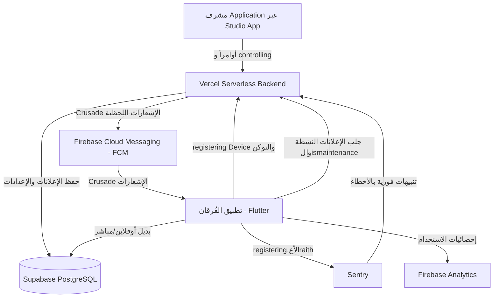

# 📖 دليل منظومة إدارة الإعلانات والمراقبة - تطبيق الفُرقان

تم بناء هذه المنظومة بالكامل لتكون مجانية 100% (Free Tier)، وتعتمد كلياً على **تطبيق AL-FURQAN STUDIO** كمركز إدارة و Hungerfull وسهل من الهاتف المحمول.

---

## 🏗️ 1. المكونات المعمارية لل_chan/system

---

## 🚀 2. خطوات التفعيل والocking (مهم للمطور والمشرف)

### الخطوة 1: في منصة Vercel
تأكد من وجود المتغيرات البيئية التالية في **Vercel -> Settings -> Environment Variables**:

| المتغير | الوصف |
| :--- | :--- |
| `SUPABASE_URL` | رابط مشروع Supabase |
| `SUPABASE_SERVICE_ROLE_KEY` | مفتاح Service Role السري للوصول الكامل |
| `FCM_SERVER_KEY` | مفتاح Cloud Messaging من إعدادات مشروع Firebase |
| `CRON_SECRET` | كلمة سر لحماية استcalls المهام المجدولة |

### الخطوة 2: قاعدة بيانات Supabase
في لوحة تحكم Supabase -> اذهب إلى **SQL Editor** ونفّذ محتوى файл `migrations.sql` لإضافة الجدول التالية:
- جدول `announcements`: لتخزين الإعلانات وروابطها وصورها.
- جدول `device_registrations`: لتسجيل توكنات أجهزة المستخدمين للإشعارات.
- جدول `system_config`: لإعدادات الصيانة والإصدار الإلزامي.

---

## 📲 3. مميزات تطبيق الفُرقان (Flutter)

1. **نافذة الإعلانات المنبضة الذكية (`AnnouncementDialog`):**
   - تصميم عربي إسلامي متناسق مع هوية Application.
   - دعم كامل للوضع الداكن (Dark Mode).
   - لا تعيق قراءة القرآن؛ تفتح بعد ثانية من فتح Application لضمان سلاسة الوجهة.
   - الإعلانات العادية قابلة للإغلاق بحرية، بينما الإعلانات الإلزامية (`isMandatory`) تتطلب اتخاذ إجراء (مثل التحديث الإجباري).
   - تخزين محلي (Cache) يتيق قراءة الإعلانات حتى في حال انقطاع الإنترنت.

2. ** registering الأجهزة والإشعارات (`FCMService`):**
   - طلب الصلاحيات بسلاسة على أندرويد 13 فما فوق.
   - registering معرفDevice والتوكن تلقائياً في السيرفر دون إثقال الشبكة.
   - إشعارات مخصصة في العمل بالخلفية والمقدمة.

3. **التحليلات والخصوصية (`AnalyticsService`):**
   - registering أحداث الاستخدام الرئيسية (فتح Application، قراءة السور، العلامات المرجعية).
   - حماية كاملة للخصوصية: يتم registering أي بيانات حساسة أو نصوص بحث خاصة بال المستخدم.
   - بطاقة خصوصية كاملة في **الإعدادات المتقدمة** تتيق للمستخدم تعطيل التحليلات في أي وقت.