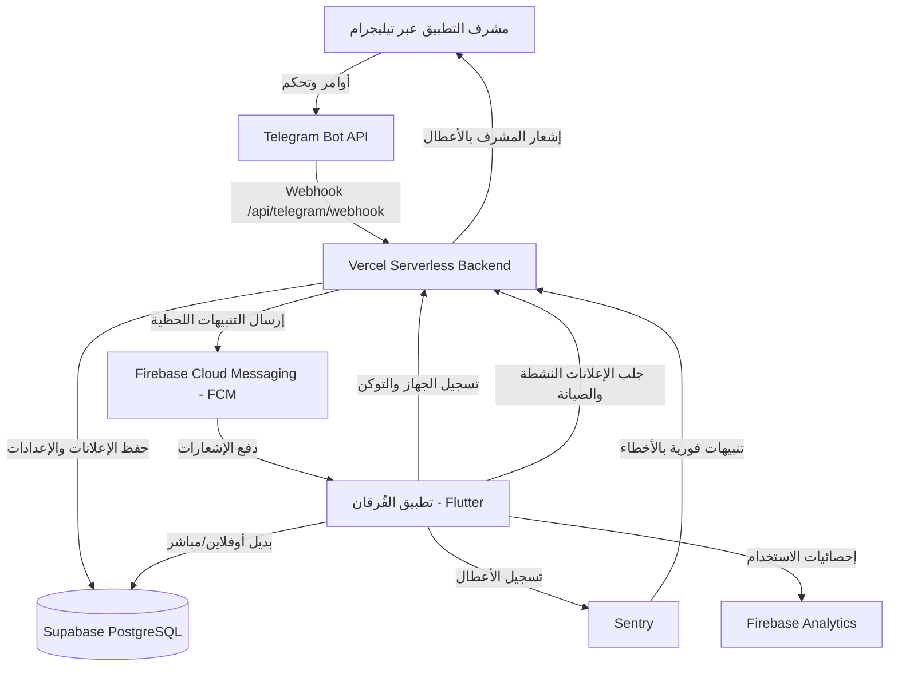

# 📖 دليل منظومة الإدارة والإعلانات والمراقبة - تطبيق الفُرقان

تم بناء هذه المنظومة بالكامل لتكون مجانية 100% (Free Tier)، بدون أي لوحة تحكم ويب تقليدية، وتعتمد كلياً على **بوت تيليجرام (Telegram Bot)** كمركز إدارة وتحكم شامل وسهل من الهاتف المحمول.

---

## 🏗️ 1. المكونات المعمارية للمنظومة



---

## 📱 2. أوامر بوت تيليجرام (@AlfurkanBot)

| الأمر | الوظيفة |
| :--- | :--- |
| `/start` | عرض لوحة التحكم الرئيسية ومعلومات النظام |
| `/announcements` | إدارة الإعلانات (إنشاء إعلان جديد، إرسال فوري، جدولة، معاينة، حذف) |
| `/notifications` | إرسال إشعار فوري (Broadcast) لجميع مستخدمي التطبيق |
| `/monitoring` | فحص صحة الخادم، والاتصال بقاعدة البيانات، وسجلات Sentry |
| `/settings` | تفعيل/تعطيل وضع الصيانة، وتحديد أقل إصدار إلزامي للتطبيق |

---

## 🚀 3. خطوات التفعيل والتشغيل (مهم للمطور والمشرف)

### الخطوة 1: في منصة Vercel
تأكد من وجود المتغيرات البيئية التالية في **Vercel -> Settings -> Environment Variables**:

| المتغير | الوصف |
| :--- | :--- |
| `TELEGRAM_BOT_TOKEN` | توكن البوت من @BotFather |
| `AUTHORIZED_ADMIN_IDS` | معرّف تيليجرام الخاص بك (مثال: `123456789`) |
| `ADMIN_CHAT_ID` | معرّف المحادثة التي تصل إليها التنبيهات اليومية والأعطال |
| `TELEGRAM_WEBHOOK_SECRET` | كلمة سر عشوائية لتأمين الويب هوك |
| `SUPABASE_URL` | رابط مشروع Supabase |
| `SUPABASE_SERVICE_ROLE_KEY` | مفتاح Service Role السري للوصول الكامل |
| `FCM_SERVER_KEY` | مفتاح Cloud Messaging من إعدادات مشروع Firebase |
| `CRON_SECRET` | كلمة سر لتأمين استدعاءات المهام المجدولة |

### الخطوة 2: ربط الويب هوك للتيليجرام
بعد اكتمال رفع السيرفر على Vercel، افتح الرابط التالي مرة واحدة في المتصفح:
```text
https://alfurkan-backend.vercel.app/api/telegram/set-webhook
```
ستظهر رسالة تؤكد ربط التيليجرام بالسيرفر بنجاح:
`{"ok": true, "result": true, "description": "Webhook was set"}`

### الخطوة 3: قاعدة بيانات Supabase
في لوحة تحكم Supabase -> اذهب إلى **SQL Editor** ونفّذ محتوى ملف `migrations.sql` لإضافة الجداول التالية:
- جدول `announcements`: لتخزين الإعلانات وروابطها وصورها.
- جدول `device_registrations`: لتسجيل توكنات أجهزة المستخدمين للإشعارات.
- جدول `system_config`: لإعدادات الصيانة والإصدار الإلزامي.

---

## 📲 4. مميزات تطبيق الفُرقان (Flutter)

1. **نافذة الإعلانات المنبثقة الذكية (`AnnouncementDialog`):**
   - تصميم عربي إسلامي متناسق مع هوية التطبيق.
   - دعم كامل للوضع الداكن (Dark Mode).
   - لا تعيق قراءة القرآن؛ تفتح بعد ثانية من فتح التطبيق لضمان سلاسة الواجهة.
   - الإعلانات العادية قابلة للإغلاق بحرية، بينما الإعلانات الإلزامية (`isMandatory`) تتطلب اتخاذ إجراء (مثل التحديث الإجباري).
   - تخزين محلي (Cache) يتيح قراءة الإعلانات حتى في حال انقطاع الإنترنت.

2. **تسجيل الأجهزة والإشعارات (`FCMService`):**
   - طلب الصلاحيات بسلاسة على أندرويد 13 فما فوق.
   - تسجيل معرّف الجهاز والتوكن تلقائياً في السيرفر دون إثقال الشبكة.
   - إشعارات مخصصة في وضع العمل بالخلفية والمقدمة.

3. **التحليلات والخصوصية (`AnalyticsService`):**
   - تسجيل أحداث الاستخدام الرئيسية (فتح التطبيق، قراءة السور، العلامات المرجعية).
   - حماية كاملة للخصوصية: لا يتم تسجيل أي بيانات حساسة أو نصوص بحث خاصة بالمستخدم.
   - بطاقة خصوصية كاملة في **الإعدادات المتقدمة** تتيح للمستخدم تعطيل التحليلات في أي وقت.
